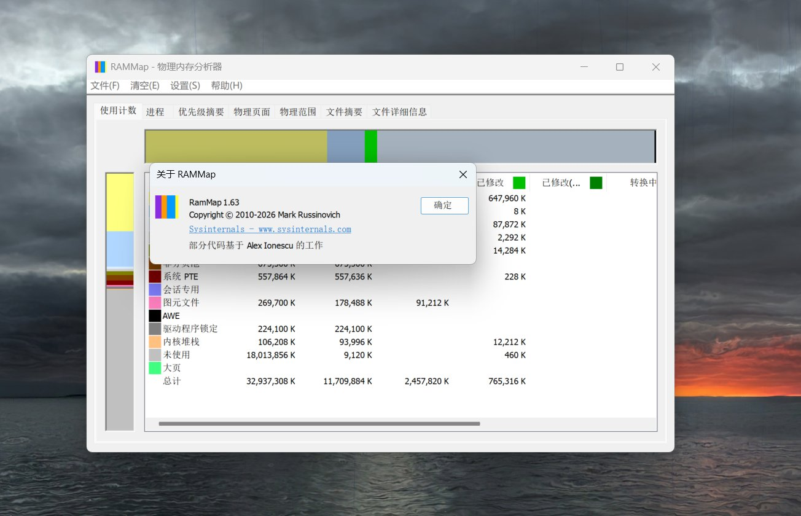

# RAMMap 外挂式中文汉化包

> 一键把 Sysinternals RAMMap 的界面变成中文 —— 不改程序代码、随时一键还原。


[](https://github.com/gxxHuang/rammap-zh-cn/releases/latest)



## 三步使用

1. **下载官方 RAMMap**（微软官网，免费）：<https://learn.microsoft.com/sysinternals/downloads/rammap>
2. **下载本工具**：从 [Releases 发布页](../../releases/latest) 下载（183 KB，免安装）
3. **点一下汉化**：运行工具 → 选择 RAMMap 目录 → 点「汉化 →」

想还原？点「← 还原原版」，汉化前已自动备份。

## 为什么选它

不用下载来源不明的"汉化版 exe"，用官方原版 + 本工具：

| | 网上的"汉化版 exe" | **本工具** |
| --- | --- | --- |
| 下载内容 | 别人重新打包的整个软件（黑盒） | 一个 183 KB 的开源小工具 |
| 汉化对象 | 它提供的那个版本 | **你自己从微软下载的原版** |
| 程序代码 | 不透明 | **零改动**（代码段哈希与原版一致） |
| 出问题 | 自认倒霉 | **一键还原**，自动备份 |
| 透明度 | 黑盒 | **全源码开源**，可自行审计 |

## 功能亮点

- 🈶 **界面全覆盖**：菜单、对话框、标签页、列头、内存类型、提示与错误消息
- ⌨️ **Alt 快捷键完整保留**：Alt+F 打开"文件"菜单照常可用
- ↩️ **一键还原**：自动生成 `.zhbak` 备份；清除失效签名，文件属性显示"无数字签名"而非"签名无效"
- 🧩 **三架构支持**：64 位 / 32 位 / ARM64
- 📦 **免安装**：单文件，双击即用

## 使用说明

**图形界面**：选择 RAMMap 目录（也可以把文件夹拖进窗口）→ 点「汉化 →」

**命令行**（方便脚本批量处理）：

```bat
RAMMap汉化工具.exe --patch   "C:\Tools\RAMMap"
RAMMap汉化工具.exe --restore "C:\Tools\RAMMap"
```

需要 .NET 8 桌面运行时（[微软官网免费下载](https://dotnet.microsoft.com/download/dotnet/8.0)，多数新系统已自带）。

## 常见问题

**支持哪个版本？** RAMMap v1.63 保证全覆盖；其他版本尽力匹配，匹配不上的保留英文。

**杀毒软件报毒？** 修改 exe 的工具容易被误报。本工具源码全开放，可自行审计、自行编译。

**为什么不做"汉化版 exe"直接分发？** 微软许可协议禁止再分发其软件。本仓库只发工具，RAMMap 本体请从官方获取。

**能汉化其他 Sysinternals 工具吗？** 暂不支持；源码在 `patcher/`（C#）与 `tools/`（Python），欢迎研究。

## 免责声明

第三方工具，与 Microsoft / Sysinternals 无任何关联；本仓库不包含任何微软软件文件；修改后的软件请勿再分发。

## 许可

[MIT](LICENSE) © 2026 gxxHuang
